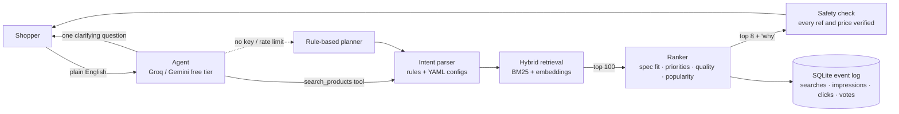

# IntentIQ

**A shopping agent that understands what you need, not just what you typed, and explains every pick.**

Describe a need in plain English ("a laptop for my MBA with some video editing, under $1,000"). IntentIQ turns it into requirements (16 GB RAM, 512 GB storage, budget), retrieves candidates with hybrid search, ranks them on how well they actually meet those requirements, and tells you why each one made the list, including where it falls short. A chat agent handles vague requests and follow-ups like "cheaper", "lighter" or "no HP".

Built to run at **$0**: open-source embeddings, a local SQLite event log, and free LLM tiers (Groq, with Gemini as a backup) behind a rule-based fallback, so the app never breaks when a free limit runs out.

> Prices and products come from a 2023 snapshot of public Amazon review data. This is a portfolio project, not a live store.

---

## Results at a glance

Measured on a 30-query golden set (15 laptop, 15 headphone queries), top 10 results:

| | Raw retrieval | Ranker A (with popularity) | Ranker B (no popularity) |
|---|---|---|---|
| **NDCG@10**, LLM-judge labels | 0.624 | 0.862 | **0.889** |
| **NDCG@10**, rule-based labels | 0.583 | 0.888 | **0.909** |
| **P@5**, rule-based labels | 0.586 | **0.938** | 0.931 |
| Queries improved vs raw | | 23 of 30 | 22 of 30 |

- **Laptops gained the most:** NDCG@10 went from 0.450 to 0.847, because retrieval alone matched words like "lightweight" to cheap 4 GB Chromebooks, and ranking checks the requirements.
- **Fixing what the evaluation found (Step 8)** raised ranker A from 0.811 to 0.862 (LLM-judge labels) by scoring CPU tiers and handling brand/model searches.
- **The LLM judge was checked against a human:** exact agreement on 15 of 20 sampled grades (75%), within one grade on 20 of 20.

**The agent**, tested on 10 multi-turn conversations (16 turns):

| | Rules only | LLM agent |
|---|---|---|
| Turns passed | 13 / 16 | **15 / 16** |
| Conversations fully passed | 7 / 10 | **9 / 10** |
| Answers blocked by the safety check | 0 | 0 |
| Median latency | 17 ms | 1.9 s |

The LLM handles what rules can't: "something to block noise on long flights" becomes headphones with noise cancelling, and "not sure, something under $100" gets a search instead of a second question.

---

## How it works



1. **Understand.** A rule-based parser with per-category YAML configs maps use cases to requirements (video editing needs 16 GB RAM; flights need noise cancelling) and reads explicit specs, budgets and weights. Vague queries return no category on purpose, so the app asks instead of guessing.
2. **Retrieve.** Hybrid search combines BM25 (exact model names) with sentence-embedding similarity (vague needs) and filters by budget.
3. **Rank.** Each candidate gets a score from five parts:

   | Component | What it measures | A | B |
   |---|---|---|---|
   | Relevance | Hybrid search score | 30% | 30% |
   | Spec fit | Meets RAM, storage, GPU, weight, noise cancelling... | 25% | 25% |
   | Priority fit | Portability, performance (incl. CPU tier), battery, comfort... | 15% | 15% |
   | Quality | Bayesian-adjusted star rating | 20% | 30% |
   | Popularity | Log number of ratings | 10% | 0% |

   Requirements are **soft penalties, not hard filters**, so users never see zero results, and every miss is stated ("8 GB RAM (you wanted 16 GB)", "entry-level CPU").
4. **Explain.** Every result carries a "why" line built from the same signals that ranked it.
5. **Converse.** The agent calls three tools (`search_products`, `compare_products`, `ask_user`), keeps filters across turns and asks at most one question in a row.
6. **Guard.** Before an answer is shown, code checks that every product reference, product ID and price in it came from the tools. If not, a safe template answer replaces it.
7. **Learn.** Searches, impressions, clicks, thumbs up/down and comparisons are logged to SQLite. Each visitor is assigned ranker A or B by hashing their session ID, which sets up an online A/B test.

---

## Design decisions

- **The LLM orchestrates; it doesn't rank.** Ranking stays deterministic and testable, and the LLM can only recommend products the tools returned.
- **Rules first, LLM second, rules again as fallback.** The app costs nothing when idle and keeps working when free limits are hit.
- **Soft requirements over hard filters.** A near miss with an honest explanation beats an empty page.
- **Bias controls built in.** A cap of 3 results per brand (lifted when the shopper names a brand or model) and a popularity weight that is capped in ranker A and removed in ranker B.
- **Evaluation before features.** Every change was measured on the golden set; the worst-query list decided what to fix next.

## What the evaluation found and changed

| Finding | Fix | Effect |
|---|---|---|
| "Lightweight laptop for video editing" returned 4 GB Chromebooks | Intent-aware ranking with spec fit | Laptop NDCG@10 0.450 → 0.755 |
| An i3 laptop ranked #1 for video editing on RAM alone | CPU tiers in the performance score | "Programming under $1,500" 0.535 → 0.660 (LLM labels) |
| "Sony WH-1000XM4" and "Legion 5" got worse after ranking | Brand cap lifted for named brands; exact-model boost | Sony query left the worst-5 list |
| Popularity weight didn't help | Ranker B kept for the A/B test | B beats A overall (0.889 vs 0.862) |
| "AirPods Pro" has no match in the catalog | Reported as a data gap | Excluded from NDCG, listed in the report |

## Known limitations

- **Small golden set.** 30 queries; differences under about 0.03 NDCG are noise.
- **Label bias.** Rule-based labels reward the same specs the ranker scores; LLM-judge labels reduce that, and were spot-checked against human grades.
- **Battery life** is read from listing text, since there is no battery field. Review-based aspect scores are the next step.
- **2023 prices**, two categories (laptops, headphones), English only.
- **Free-tier limits.** The LLM agent falls back to rules when Groq's per-minute limit is reached.

## Run it locally

```bash
git clone https://github.com/rihaanbhayana-byte/intentiq.git
cd intentiq
uv venv && source .venv/bin/activate
uv pip install -r requirements.txt

# optional: free keys for the LLM agent (without them it uses rules)
cp .env.example .env        # paste GROQ_API_KEY / GEMINI_API_KEY

uvicorn api:app --app-dir src --reload
# search page: http://127.0.0.1:8000    chat agent: http://127.0.0.1:8000/agent
```

Reproduce the numbers:

```bash
python src/evaluate.py                               # ranking, rule-based labels
python src/judge.py && python src/judge.py --check 20   # LLM-judge labels + human spot check
python src/evaluate.py --labels eval/labels_llm.csv  # ranking, LLM-judge labels
python src/evaluate_agent.py --mode rules llm        # agent conversations
```

## Project layout

```
src/
  ingest.py, features.py, finalize.py   build the catalog from the raw dataset
  embed.py, search.py                   embeddings and hybrid retrieval
  parse.py                              rule-based intent parser
  rank.py                               scoring, explanations, brand cap
  agent.py, llm.py                      chat agent, free LLM client, rule fallback
  api.py                                FastAPI backend, event logging, A/B assignment
  evaluate.py, criteria.py              offline ranking evaluation
  judge.py                              LLM-as-judge labels + human agreement check
  evaluate_agent.py                     multi-turn agent tests
configs/   per-category use cases and priorities (YAML)
app/       search page and chat page
eval/      golden set, labels and saved results
```

## Next steps

- Review-based aspect scores (battery, build quality, comfort) to replace keyword matching.
- Run the online A/B test (ranker A vs B) with real users and compare click-through and thumbs-up rates.
- Grow the golden set and add a third category.
